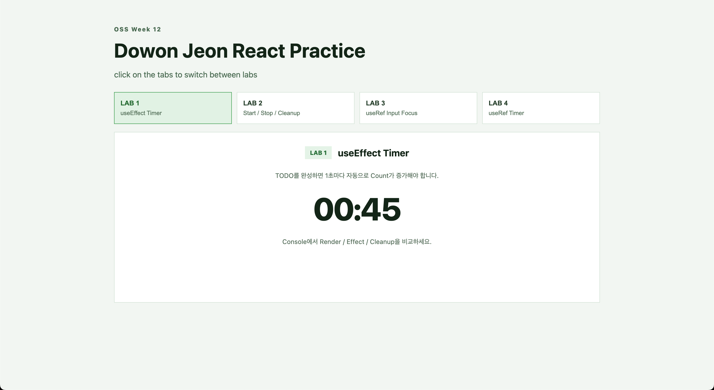

# 오픈소스 스튜디오 01분반

22300650 / 전도원

## Assignment 12. React Hooks (useEffect & useRef)

## Project Information

프로젝트 소개: useEffect와 useRef를 연습하는 React Hooks 실습 페이지.
주요 기능:

1. LAB 1: useEffect로 1초마다 Count 증가
2. LAB 2: running State로 Timer Start / Stop / Reset
3. LAB 3: useRef로 Input Focus / Clear
4. LAB 4: useRef에 Timer ID 저장 후 Start / Stop / Reset

Starter Project URL: https://github.com/2026-2-OSS/week12_starter_project

## Installation

```
git clone https://github.com/2026-2-OSS/assign12-c01-22300650.git
cd assign12-c01-22300650
npm install
npm run dev
```

실행 화면:


## Source Code Exploration

### Project Structure

1. App.jsx: labs 배열과 active state를 사용해서 선택된 Lab 하나만 화면에 보여준다. 탭을 바꾸면 이전 Lab은 언마운트된다.
2. Lab1_EffectTimer.jsx: useEffect + setInterval 자동 Timer
3. Lab2_TimerControl.jsx: running state로 Timer on/off
4. Lab3_InputFocus.jsx: useRef로 input DOM 접근
5. Lab4_RefTimer.jsx: useRef에 Timer ID를 저장해서 Timer 관리

### useEffect

렌더링 후에 실행되는 함수이다. Dependency Array의 값이 바뀔 때만 다시 실행되고, []이면 마운트 때 한 번만 실행된다. return한 함수는 다음 Effect 실행 전이나 언마운트 때 실행된다.

### useRef

Timer ID 저장이나 DOM 접근에 사용한다. .current에 값을 저장하는 객체를 만든다. 렌더링이 되어도 값이 유지되고, .current를 바꿔도 다시 렌더링되지 않는다.

주요 코드 1 (useEffect):

```jsx
useEffect(() => {
  console.log("lab1: timer start");

  const id = setInterval(() => {
    setCount((prev) => prev + 1);
  }, 1000);

  return () => {
    clearInterval(id);
    console.log("lab1: timer cleared");
  };
}, []);
```

설명: []라서 처음 한 번만 Timer를 만든다. prev => prev + 1로 이전 값을 받아서 Effect가 다시 실행되지 않아도 count가 계속 올라간다. 탭을 이동하면 Cleanup에서 Timer가 정리된다.

주요 코드 2 (useRef):

```jsx
const inputRef = useRef(null);

const focusInput = () => {
  inputRef.current.focus();
};

const clearInput = () => {
  inputRef.current.value = "";
  inputRef.current.focus();
};

...

<input id="student-name" className="field" placeholder="Enter your name" ref={inputRef} />
```

설명: ref={inputRef}로 연결하면 inputRef.current에 input DOM이 들어가서 getElementById 없이 바로 focus()를 호출할 수 있다.

## Lab Implementation

### LAB 1. useEffect Timer

수정한 파일: src/components/Lab1_EffectTimer.jsx

구현 내용: useEffect 안에서 setInterval로 setCount(prev => prev + 1)을 실행하고 Cleanup에서 clearInterval(id)로 정리. Dependency Array는 [].

실행 결과: 1초마다 Count가 증가하고, 탭을 이동하면 Timer가 초기화된다.

### LAB 2. Timer Start / Stop

수정한 파일: src/components/Lab2_TimerControl.jsx

구현 내용: running이 true일 때만 setInterval을 실행하고, Dependency Array에 running을 넣었다. Reset은 setRunning(false), setCount(0).

실행 결과: Start / Stop / Reset 기능이 작동한다. 탭을 이동하면 타이머가 초기화된다.

### LAB 3. Input Focus with useRef

수정한 파일: src/components/Lab3_InputFocus.jsx

구현 내용: inputRef를 input에 연결하고, Focus는 inputRef.current.focus()로 입력창이 포커스 되게 하고, Clear는 value를 ""로 바꾼 뒤 focus()로 값 초기화 후 포커스 실행.

실행 결과: Focus 버튼은 입력창에 포커스를 주고, Clear 버튼은 내용을 지우고 포커스한다.

### LAB 4. Timer with useRef

수정한 파일: src/components/Lab4_RefTimer.jsx

구현 내용: Timer ID를 timerRef.current에 저장하고 start()는 이미 값이 있으면 return해서 중복 실행을 막는다. stop()은 clearInterval 후 null로 초기화, reset()은 stop() 후 count를 0으로 변경한다. useEffect(fn, [])의 Cleanup에서 언마운트 시 Timer를 정리한다.

실행 결과: LAB 2와 똑같이 동작하고 탭을 이동하면 Timer가 정리된다.

## Lab Comparison

1. useEffect의 Dependency Array가 필요한 이유는?

Effect를 언제 다시 실행할지 정하기 위해서이다. 없으면 렌더링마다 실행되어 Timer가 계속 새로 생기거나 무한 렌더링이 생길 수 있다.

2. Cleanup을 사용하지 않으면 어떤 문제가 발생할 수 있는가?

이전 Timer가 계속 남아서 여러 개가 겹칠 수 있고 사라진 컴포넌트의 state를 계속 바꾸려 해서 메모리가 낭비된다.

3. useState와 useRef의 가장 중요한 차이는?

useState는 값이 바뀌면 다시 렌더링되고, useRef는 .current를 바꿔도 렌더링되지 않는다.

4. LAB 2와 LAB 4의 Timer 관리 방식은 어떻게 다른가?

LAB 2는 running state가 바뀌면 useEffect가 Timer를 만들고 정리한다. LAB 4는 버튼으로 setInterval / clearInterval을 실행하고 Timer ID를 ref에 저장한다. useEffect는 언마운트 정리용으로만 쓴다.

## Customizing

수정한 파일: index.html, src/App.jsx, src/App.css

- 탭 제목을 Timer로 변경
- 헤더 제목과 설명 변경, 쓸데없는 요소 (footer 등) 삭제
- 파란색 테마를 초록색으로 변경
- border radius, 그림자 삭제
- Lab 패널 내용 가운데 정렬

## Feature Extension

1. Timer Count를 분/초 형식으로 표시

수정한 파일: src/utils/formatTime.js(추가), Lab1_EffectTimer.jsx, Lab2_TimerControl.jsx, Lab4_RefTimer.jsx

```js
export function formatTime(count) {
  let minutes = Math.floor(count / 60);
  let seconds = count % 60;

  if (minutes < 10) minutes = "0" + minutes;
  if (seconds < 10) seconds = "0" + seconds;

  return minutes + ":" + seconds;
}
```

```jsx
<div className="count">{formatTime(count)}</div>
```

동작 결과: 분:초 형식으로 표시된다. LAB 1, 2, 4에서 같이 쓰려고 함수를 파일로 분리했다.

## Deployment

GitHub URL: https://github.com/2026-2-OSS/assign12-c01-22300650

Vercel URL: https://2026ossw12.vercel.app/

## Weekly Review

새롭게 배운 내용:

1. Dependency Array에 따라 Effect 실행 시점이 달라지고, Cleanup이 이전 작업을 정리한다.
2. useRef는 렌더링 없이 값을 유지해서 Timer ID 저장에 좋다.
3. 개발 모드의 StrictMode에서는 Effect가 한 번 더 실행된다.

어려웠던 점과 해결 방법: Console에 effect와 cleanup이 두 번씩 찍혀서 코드가 잘못된 줄 알았는데, StrictMode가 개발 모드에서 Cleanup 확인을 위해 Effect를 한 번 더 실행하는 것이었고, 배포된 화면에서는 한 번만 실행되는 것을 확인할 수 있었다.

AI 활용 내용 및 느낀 점:

도구: Claude (Claude Code)

사용목적: 설명 및 검토

AI가 도와준 것: Starter Project 구조 설명, StrictMode 동작 설명, 제출 전 검토, 색상 코드 추천

직접 수행한 작업: Lab TODO 구현, Customizing, README 작성

느낀 점: 기능을 추가적으로 구현하고 확장시키는 작업이 재밌었다.

본인 추정 AI 기여율(%): 20%
